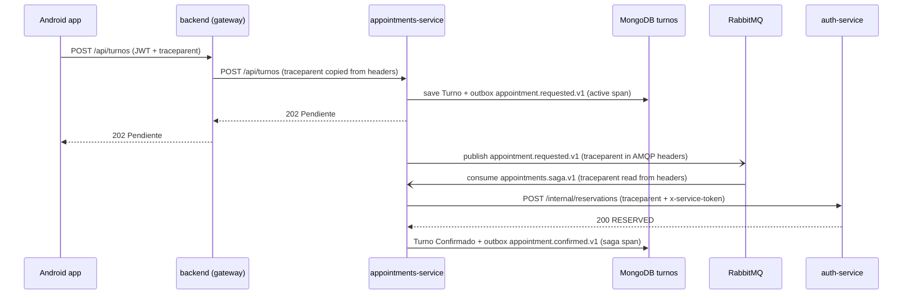

# 01 · Critical journey: booking an appointment

## Journey

The patient books an appointment from the Android app with `POST /api/turnos`.
The topology comes from `docker-compose.yml`: `backend` (port 3000, acts as the
gateway), `appointments-service` (3002), `auth-service` (3001), MongoDB and
RabbitMQ. The appointment is created as `Pendiente` and a saga confirms it later.

## Hop table

| Step | Caller | Receiver | Protocol | Operation | Sync/Async | Data | Trace context |
|------|--------|----------|----------|-----------|------------|------|---------------|
| 1 | Android app | backend (`server.js`) | REST + JWT | `POST /api/turnos` | sync | none | `traceparent` (HTTP header) |
| 2 | backend (`proxyTo`) | appointments-service | REST | `POST /api/turnos` | sync | none | `traceparent` (copies `req.headers`) |
| 3 | appointments-service | MongoDB `turnosConnection` | Mongoose | saves `Turno` with `outboxEvents[appointment.requested.v1]`, returns 202 | sync | `Turno` | active span; `traceparent` must be stored in the outbox event |
| 4 | outbox relay (every 1 s) | RabbitMQ `salud-activa.events.v1` | AMQP | publishes `appointment.requested.v1` | async | exchange | `traceparent` in `properties.headers` |
| 5 | RabbitMQ `appointments.saga.v1` | appointments-service (consumer) | AMQP | `saga.handleRequested` | async | queue | `headers.traceparent` is read and the trace continues |
| 6 | appointments-service | auth-service | REST + `x-service-token` | `POST /internal/reservations` | sync | `AppointmentReservation` | `traceparent` (HTTP header) |
| 7 | appointments-service | MongoDB `turnosConnection` | Mongoose | `Turno` becomes `Confirmado`, `appointment.confirmed.v1` is added | sync | `Turno` | active span of the saga |

Compensation: if step 6 fails with 404 or 409, the service calls
`DELETE /internal/reservations/:id` and the appointment ends as `Cancelado`
(`appointment.cancelled.v1`). After 6 failed attempts the message goes to
`appointments.saga.v1.dead`.

## Sequence diagram

## Span tree

- `POST /api/turnos` (SERVER, backend, root, trace_id = T)
  - `proxy POST /api/turnos` (CLIENT, backend)
    - `POST /api/turnos` (SERVER, appointments-service)
      - `mongo Turno.save` (CLIENT, `turnosConnection`)
  - `publish appointment.requested.v1` (PRODUCER, outbox relay, async boundary, same trace_id = T)
    - `consume appointments.saga.v1` (CONSUMER, appointments-service, trace_id = T)
      - `saga.handleRequested` (INTERNAL)
        - `POST /internal/reservations` (CLIENT, appointments-service)
          - `POST /internal/reservations` (SERVER, auth-service)
            - `mongo AppointmentReservation.findOneAndUpdate` (CLIENT)
        - `mongo Turno.findOneAndUpdate` (CLIENT, `finish`)

## How the context propagates

- **HTTP:** the `traceparent` header has the form
  `00-<trace_id>-<span_id>-01`. The receiver creates a child span with the same
  `trace_id` and a new `span_id`. `proxyTo` copies `req.headers`, so the header
  reaches `appointments-service` from `backend` unchanged.
- **RabbitMQ:** the broker propagates nothing by itself. The producer writes
  `traceparent` into `properties.headers` and the consumer reads it from there.
- **Outbox:** the event is stored in `Turno.outboxEvents` and published later,
  when there is no active span. So `traceparent` must be saved inside the event
  when it is created and copied into the headers in `publish()`.
- **Retries:** the consumer already copies the existing headers when it retries,
  so `traceparent` survives retries and the dead-letter queue.
