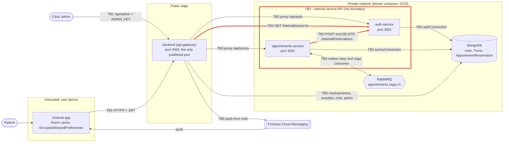

# 01 · Attack surface and trust boundaries

Scope: the Salud Activa (`appt-mgmt`) system as it runs today with `docker-compose.yml`
in the code repository: the `backend` gateway, `auth-service`, `appointments-service`,
MongoDB and RabbitMQ, plus the Android app and Firebase Cloud Messaging. My boundary is
**TB2**, highlighted in red.

## Data flow diagram

| Boundary | Crosses from, to | Protocol and authentication today |
|---|---|---|
| TB1 | Android app or admin, to `backend` gateway | HTTPS from the app, JWT (HS256, 30 days) or `ADMIN_KEY` |
| TB2 (mine) | `backend` and `appointments-service`, to `auth-service` `/internal/*` | plain HTTP, one shared `x-service-token` |
| TB3 | `backend` gateway, to `auth-service` and `appointments-service` public routes | plain HTTP, user JWT forwarded, verified again with the shared `JWT_SECRET` |
| TB4 | `appointments-service`, to and from RabbitMQ | `amqp://` with no explicit credentials in the compose file |
| TB5 | Services, to MongoDB | connection string in `MONGODB_URI` |
| TB6 | `backend`, to Firebase Cloud Messaging | Firebase Admin credential in `FIREBASE_SERVICE_ACCOUNT` |

## Asset inventory

| Asset | Where it lives | Classification |
|---|---|---|
| Patient health profile: `tipoSanguineo`, `alergias`, `condiciones`, `contactoEmergencia` | `User` in `authConnection`; returned by `GET /internal/users/:id` | restricted |
| Password hash, `verificationCode` | `User` in `authConnection` | restricted |
| `JWT_SECRET` (signs every user token) | environment of `backend`, `auth-service`, `appointments-service` | restricted |
| `SERVICE_TOKEN` (the only service-to-service credential) | environment of `backend`, `auth-service`, `appointments-service` | restricted |
| Patient identity and contact: `nombre`, `email`, `telefono` | `User` in `authConnection` | confidential |
| Appointments: `fecha`, `hora`, `motivo`, `especialidad`, `estado`, `sagaStatus` | `Turno` in `turnosConnection` | confidential |
| `fcmToken` (push device token) | `User` in `authConnection` | confidential |
| Reservations: `reservationId`, `userId`, `status` | `AppointmentReservation` in `authConnection` | internal |
| Saga events (`appointment.requested.v1`) | `Turno.outboxEvents` and queue `appointments.saga.v1` | internal |

## Entry points of TB2

| Entry point | Caller | How it is authenticated today |
|---|---|---|
| `POST /internal/reservations` on `auth-service` (port 3001) | `appointments-service`, saga step through `authClient.reserveAppointment` | `x-service-token` equal to `SERVICE_TOKEN`, compared with `!==`; no caller identity |
| `DELETE /internal/reservations/:reservationId` | `appointments-service`, saga compensation and appointment cancellation | same |
| `GET /internal/users/:id` | `backend`, `middleware/auth.js`, on every authenticated request when `AUTH_SERVICE_URL` is set | same; returns the full profile, but the code only reads `fcmToken` |
| Port 3001, plain HTTP | any container in the compose network; no host port is published | network reachability only; `/api/auth/*` (register and login) shares the same listener |
| `GET /health/live`, `GET /health/ready` | container healthchecks | none; `ready` shows the database status |
